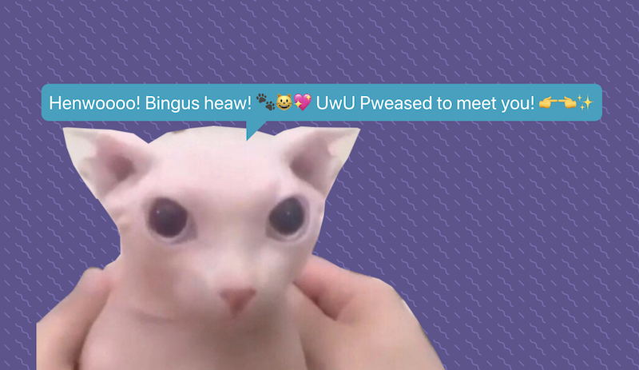

# MS Bingus



Just a silly little catbot.

Live at https://msbingus.dansakamoto.com

## Development

Bingus was built in React and uses the ChatGPT API.

## Requirements

- Node.js
- OpenAI API Key

## Quickstart

Rename .env.example to .env and add a valid OpenAI API key to the file. Then run:

```
npm install
npm start
```
